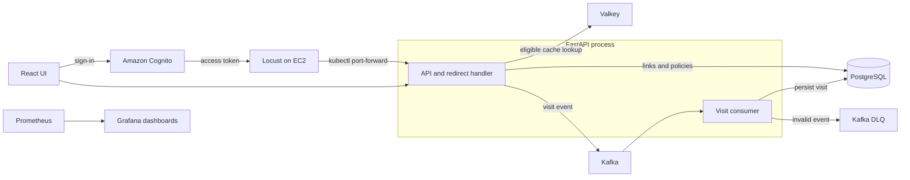

# Zipp: Performance Testing an Event-Driven Application

Zipp demonstrates repeatable performance testing and observability across an API, cache, database, and asynchronous Kafka pipeline. Version-controlled Locust scenarios and load shapes run locally or through GitHub Actions, with Grafana evidence and a browsable report history for each published run.


**[Explore all performance reports](https://monishcse982.github.io/zipp/)** · [250-user ramp and spike](https://monishcse982.github.io/zipp/runs/43018942404-1-e72b2c2/index.html) · [200-user spike](https://monishcse982.github.io/zipp/runs/43005546299-1-e72b2c2/index.html) · [GitHub Actions](https://github.com/monishcse982/zipp/actions)

Each published run includes the native Locust report, application and infrastructure dashboard screenshots for the test window, run metadata, and a link to the Actions execution. The complete run evidence is also retained as an Actions artifact for 90 days.

## Results at a glance

| Run | Workload | Achieved RPS | Redirect p50 / p95 / p99 | Recorded failures | Verdict |
| --- | --- | ---: | --- | ---: | --- |
| [200-user spike](https://monishcse982.github.io/zipp/runs/43005546299-1-e72b2c2/index.html) | Up to 200 users, 5-minute preset | 15.86 aggregate | 760 / 3,600 / 4,700 ms | 0% (0 / 4,006 aggregate) | Not evaluated |
| [250-user ramp and spike](https://monishcse982.github.io/zipp/runs/43018942404-1-e72b2c2/index.html) | Ramp with additive spikes, 10-minute preset | 89.94 redirects | 330 / 1,400 / 2,200 ms | 0% (0 / 53,959 redirects) | Not evaluated |

These runs have different load shapes and are not a before/after comparison. Latencies are for `GET /link/{short_code}`; the first RPS and failure figures include all measured request types. The spike report's measured first-to-last-request interval is shorter than its five-minute preset. No acceptance targets were set for these runs, so neither is labeled a pass.

### Observations and limits

- The ramp run recorded 53,959 redirects with no Locust-recorded failures; this does not establish that every asynchronous visit was persisted. See its [Locust report](https://monishcse982.github.io/zipp/runs/43018942404-1-e72b2c2/report.html) and dashboard snapshots.
- The spike run's redirect p95 was 3.6 seconds. Its [report and dashboards](https://monishcse982.github.io/zipp/runs/43005546299-1-e72b2c2/index.html) show the observation, but do not establish the cause. Repeat comparable runs before attributing or claiming a fix.
- The load generator and K3s workloads share one EC2 host, and traffic reaches the API through `kubectl port-forward`. Either shared resource pressure or the tunnel can affect the result. No direct-path comparison or repeated-run variance has been established; these are feasibility observations, not capacity benchmarks.

## System under test

The FastAPI service creates and manages links in PostgreSQL. Redirects exercise policy checks and eligible cache lookups in Valkey; visit events flow through Kafka to a consumer that persists visit details. A React UI uses Amazon Cognito for sign-in. Prometheus scrapes application and infrastructure metrics, which are visualized in separate Grafana dashboards.



The application, its dependencies, and observability stack run in separate namespaces on a single K3s cluster hosted on EC2. The visit consumer runs inside the API process. The self-hosted GitHub Actions runner also runs on that EC2 instance.

## Test design

Scenarios, load shapes, and presets are separate so each workload can be adjusted without rewriting the API client:

| Component | Location | Purpose |
| --- | --- | --- |
| Scenarios | [tests/load/scenarios](tests/load/scenarios) | User behavior and API interactions |
| API helpers | [tests/load/scenarios/helpers](tests/load/scenarios/helpers) | Shared authentication and API calls |
| Load shapes | [tests/load/patterns](tests/load/patterns) | User arrival, concurrency, spikes, steps, and recovery |
| Presets | [tests/load/presets](tests/load/presets) | Named, version-controlled scenario and shape parameters |

### Scenarios and workload mix

| Scenario | Behavior | Example preset |
| --- | --- | --- |
| Mixed redirects | Each user authenticates, creates four links, then selects public, password-protected, IP-restricted, and visit-limited visits with weights 70/15/10/5. | `mixed_redirect_spike_user_200user_5minutes` |
| Management API | Authenticated users primarily list and read links, with some create, update, and disable operations. | `management_api_constant_user_50user_10minutes` |
| Write-heavy creation | Authenticated users repeatedly create links with different policies, TTLs, and optional titles. | `write_heavy_constant_user_50user_10minutes` |

Task weights are probabilities, not guaranteed request totals. Setup calls, wait time, task durations, failures, and random selection affect the measured mix. A user repeatedly selects tasks until the load shape removes it or the run ends.

These Locust user workloads are closed-model: a user waits for its task to finish before starting another. As latency rises, users generate fewer requests, which can hide delays that would occur under an independent arrival rate (coordinated omission). Compare achieved RPS alongside user counts.

Cognito authentication happens once per user during `on_start`, using a direct HTTP request outside Locust's request statistics. Login latency is not in the reported request percentiles, but it occurs during the run, can affect user startup, and can be throttled by Cognito. The link-creation setup calls are recorded in Locust statistics.

Available presets include a 100-user constant run, 200-user spikes, a 250-user step profile, a ramp with additive spikes, burst and recovery, a 50-user one-hour soak, and management and write-heavy workloads. Inspect the preset and its shape for exact timing and user counts. User counts represent concurrent virtual users, not requests per second. In the 250-user ramp preset, each 50-user spike is added to the current baseline; the spike does not necessarily reach 300 users.

## Run a test from GitHub

Start EC2 manually and confirm K3s, the application, Grafana, the `zipp-port-forwards` service, and the `zipp-load` self-hosted runner are available. The workflow does not manage the instance lifecycle. The `load-test-ec2` GitHub environment must contain:

- Variables: `LOAD_TEST_BASE_URL`, `LOAD_TEST_ENVIRONMENT`, and `GRAFANA_BASE_URL`.
- Secrets: `COGNITO_CLIENT_ID`, `COGNITO_API_USERNAME`, and `COGNITO_API_PASSWORD`.

For the existing EC2 setup, the API and Grafana URLs point to `http://127.0.0.1:8080` and `http://127.0.0.1:3000` respectively.

In **Actions → Run load test → Run workflow**, select a preset and provide a run note. Alternatively:

```bash
gh workflow run load-test.yml --ref master \
  -f preset=mixed_redirect_spike_user_200user_5minutes \
  -f run_note='Compare redirect latency under a five-minute spike profile'

gh run watch
```

The workflow validates the preset, checks API liveness and readiness and Grafana rendering, runs Locust, and captures both dashboards for the test window. It scans report files for configured credentials and token patterns, uploads the run as a 90-day Actions artifact, and publishes a sanitized report bundle and history to GitHub Pages. Load tests against this environment are serialized.

The workflow publishes observations and does not currently enforce performance thresholds. Define meaningful objectives before treating a run as a performance pass or failure.

## Run locally

Start the application and its dependencies using the [operations guide](docs/operations-guide.md), and ensure the API is reachable at `http://localhost:8080`. For Minikube, keep `make port-forward-all` running; EC2 uses the persistent forwarding service. Python and [uv](https://docs.astral.sh/uv/) are required. Configure a dedicated Cognito test user with the following environment variables; the runner also sources the ignored project `.env` file as shell syntax, so quote values containing shell metacharacters.

```bash
export COGNITO_CLIENT_ID='<app-client-id>'
export COGNITO_API_USERNAME='<test-user>'
export COGNITO_API_PASSWORD='<test-password>'

./tests/load/run-load-test.sh --help
./tests/load/run-load-test.sh --list
./tests/load/run-load-test.sh mixed_redirect_constant_user_100user_5minutes \
  --base-url http://localhost:8080
```

Local evidence is saved under `reports/load/<preset>/<timestamp>/`: the Locust HTML report, CSV statistics and history, log, executed command, and preset snapshot. Credentials and generated tokens must stay out of source control and shared reports.

## Interpret a run

Before running, record the question, expected behavior, workload, target version, and relevant thresholds. Compare request counts, response codes, failures, throughput, and latency percentiles with application and infrastructure graphs over the same test window. Check pod restarts and dependency health when investigating changes. Record observations and uncertainty alongside links to the report and Actions run.

Locust's **Final ratio** section describes configured task weights and final user-class counts; it is not a count of executed requests. A shape that ends with zero users can display zero for the final class and total ratios. Use request statistics for observed traffic.

A successful workflow confirms execution and publication; it does not establish a performance pass without explicit thresholds. The cache-hit graph can help explain results, but a run-specific hit ratio and database-load comparison have not yet been validated. Consumer lag and redirect-to-persistence latency are not yet verified as end-to-end indicators.

## Test strategy

| Layer | Coverage | Status |
| --- | --- | --- |
| Unit and API | Backend unit tests, authenticated API tests, and Bruno requests | Available |
| Load | Locust scenarios, versioned presets, reports, and Grafana snapshots | Available; thresholds pending |
| Chaos | Hypothesis-driven failure tests under load | Planned with Litmus |
| Browser E2E | Real authenticated browser journeys | Planned |

## Known limitations

- Valkey is required during startup and cache operations are not best-effort; a cache outage may affect redirects.
- Visit processing is not idempotent by event ID; retries can produce duplicates. Asynchronous publishing does not establish loss-free delivery during broker failure.
- IP-restricted links need validation behind a trusted reverse proxy.
- Load-generator co-location and the port-forward path limit capacity conclusions. See the [roadmap](docs/roadmap.md) for planned validation.

## Deployment and observability

Pull requests run Python and frontend checks, unit tests, Helm validation, workflow validation, image builds, and secret scans. Successful pushes to `master` publish API and UI images to GHCR using immutable commit-SHA tags and deploy the application release to EC2. A separate [manual deployment workflow](.github/workflows/deploy-ec2.yml) supports a specific previously published SHA. The deployment and load-test workflows use different concurrency groups, so coordinate deployments and tests to avoid overlapping them. The current EC2 runner has both `zipp-ec2` and `zipp-load` labels. Infrastructure and observability chart changes require an explicit stack update.

The EC2 port-forward service keeps the API, UI, Grafana, Prometheus, PostgreSQL, and Valkey available on host loopback, with recovery after stale forwards. [EC2 setup and operations](docs/operations-guide.md) cover configuration, deployment, access, and troubleshooting. Dashboard definitions live in [deploy/charts/zipp-observability/dashboards](deploy/charts/zipp-observability/dashboards).

## Next improvements

- Define and gate agreed latency and error objectives; repeat the same preset to quantify variance before claiming a regression or improvement.
- Compare direct cluster access with the port-forward path, then move the load generator to a separate host.
- Measure consumer lag and event-to-persistence latency, and add end-to-end reconciliation.
- Run bounded Litmus chaos hypotheses under load and correlate recovery with application and infrastructure metrics.
- Host the application on Amazon EKS to explore a managed Kubernetes deployment.
- Host the load runner on EKS and scale load generation independently of the application.

## Documentation

- [Load-test scenarios](docs/load-test-scenarios.md): implemented coverage and proposed experiments.
- [Operations guide](docs/operations-guide.md): local and EC2 setup, deployment, and troubleshooting.
- [Roadmap](docs/roadmap.md): next improvements and known opportunities.
- [Cognito API and UI design](docs/cognito-management-ui-plan.md): authentication and management decisions.
- [Litmus experiment proposals](docs/chaos-experiments.md): hypotheses, evidence, and safety boundaries.
