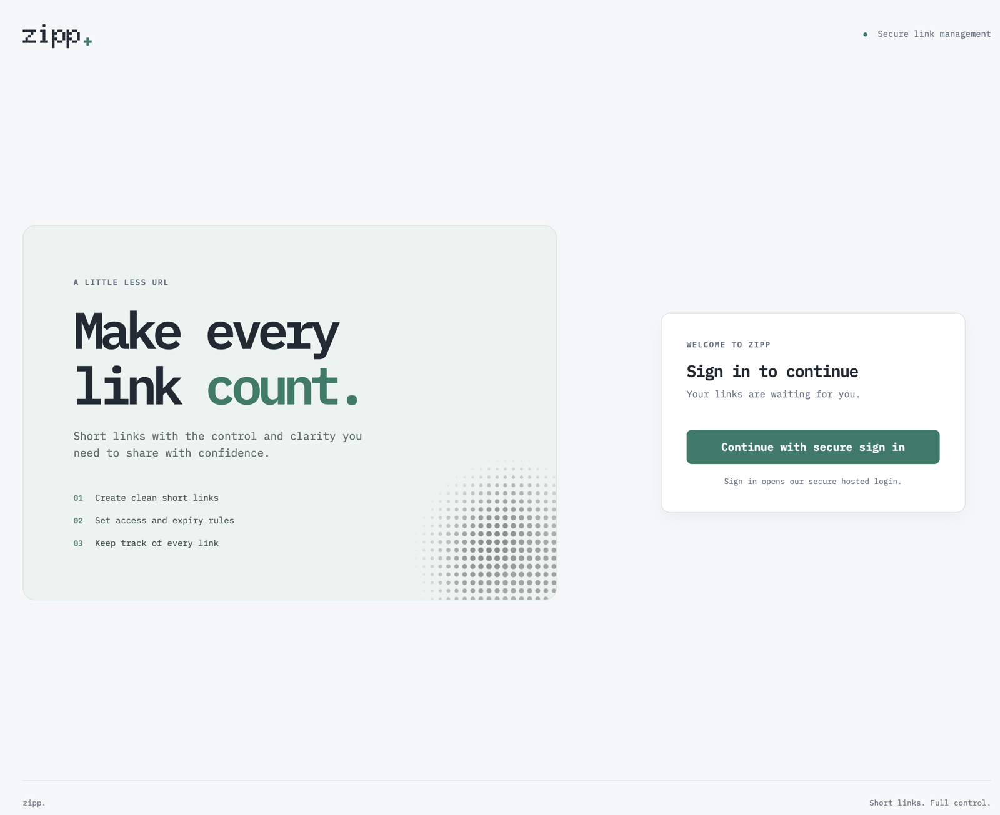
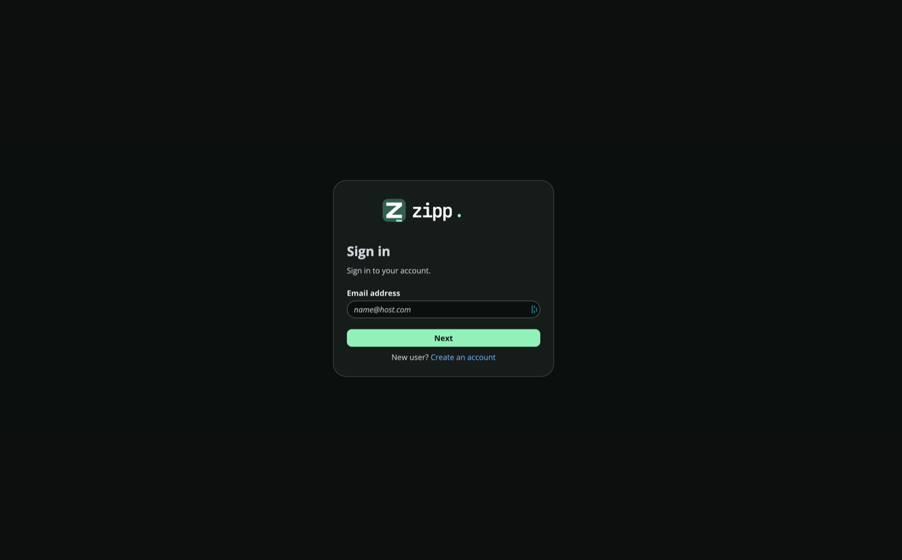
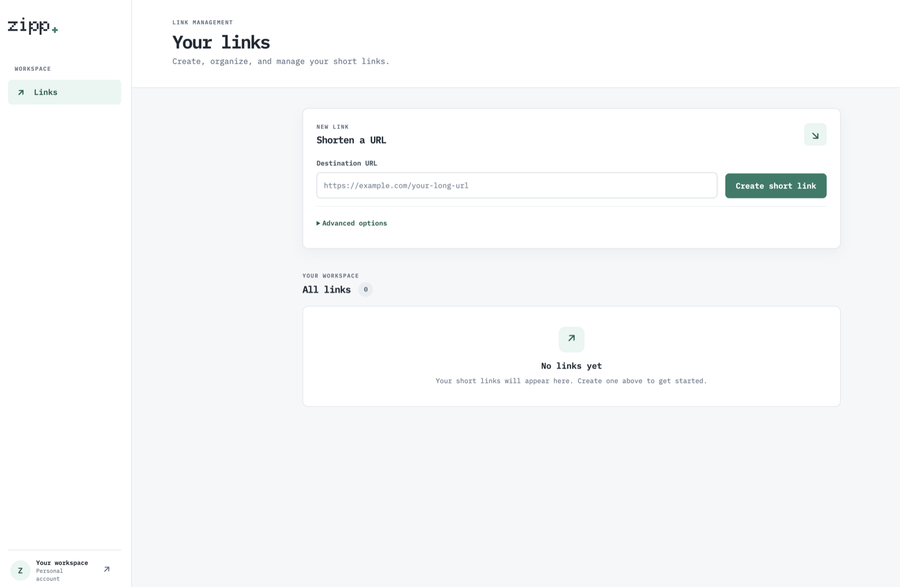
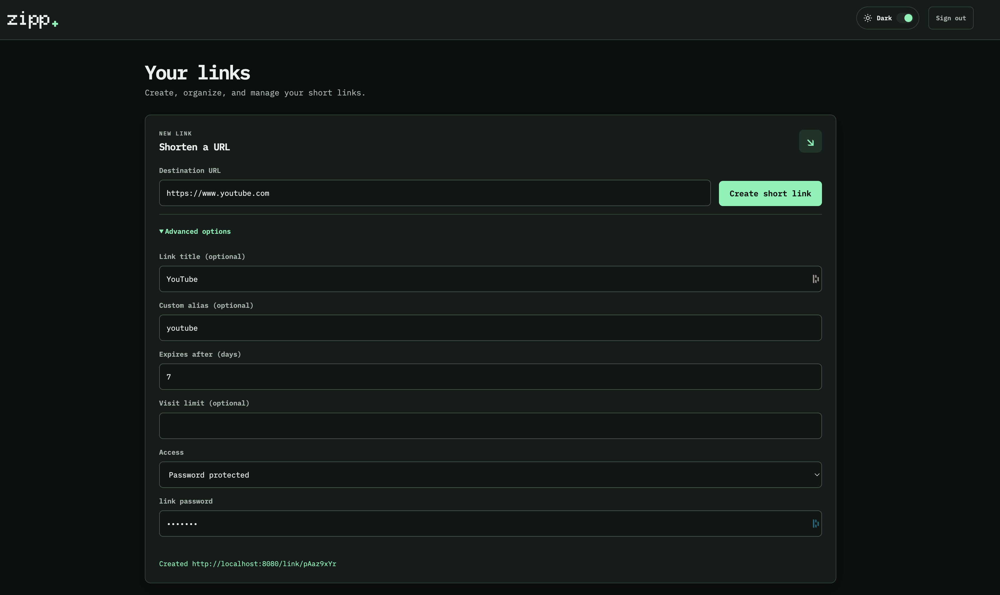

# Zipp

A FastAPI URL shortener built as a small event-driven system. It creates short links, redirects visitors, publishes visit events to Kafka, and persists visit details asynchronously in PostgreSQL. The repository also includes local Kubernetes deployment, Prometheus/Grafana observability, and repeatable Locust load profiles.

**Project status:** the current local application scope is complete. EKS hosting is deferred as a separate learning exercise. See [the project status and deferred roadmap](docs/roadmap.md).

## Current Capabilities

### Application

- Create short links with generated or custom codes.
- Validate HTTP/HTTPS destinations with Pydantic.
- Configure a title, TTL, and maximum visit count.
- Disable an active short link while preserving its row and visit history.
- Redirect valid short codes with `302 Found`.
- Return `404 Not Found` for unknown or soft-deleted links.
- Return `410 Gone` when a link has expired or reached its visit limit.
- Soft delete expired or exhausted links when they are accessed.
- Capture visit time, user agent, referrer, and IP address.
- Publish visit events to Kafka and persist them asynchronously.
- Send malformed Kafka messages to a dead-letter topic.
- Emit plain-text or JSON logs with correlation IDs.
- Expose FastAPI, application, and Kafka Prometheus metrics at `/metrics`.
- Provide `/dummy-target` for redirect and load testing.

### User interface

| Zipp welcome screen | Cognito hosted sign-in | Link management |
| --- | --- | --- |
|  |  |  |

| Link options | Link details |
| --- | --- |
|  |  |

### Infrastructure

- Local Kubernetes cluster through Minikube.
- Helm application and umbrella charts.
- PostgreSQL 18 with persistent storage and initialization SQL.
- Single-node Kafka in KRaft mode managed by Strimzi.
- SCRAM-SHA-512 Kafka authentication.
- Declaratively managed `link.visited` and `link.visited.dlq` topics.
- Prometheus Operator, Prometheus, Grafana, kube-state-metrics, and node exporter.
- Persistent Prometheus storage with two-day retention and a 4 GiB data cap.
- Automatically provisioned Zipp Grafana dashboard.

### Tests

- Unit tests for supported link policy validation and creation persistence.
- Locust scenarios for link creation, redirect traffic, and the complete create-and-visit flow.
- Ramp, constant, constant-concurrent, spike, step, and approximate constant-RPS load shapes.
- Named five-minute presets.
- Timestamped HTML, CSV, log, command, and preset artifacts under `reports/load/`.

Each load scenario covers all nine combinations of `public`,
`password_protected`, and `ip_restricted` policies with time-only, visit-only,
and combined expiry/visit-limit settings. Each completed creation task creates
one link per combination; each visit task visits each combination once. The
complete-flow task creates each combination and attempts eleven visits per link,
checking the final redirect or visit-limit response.
Password protected links show a browser unlock form. API callers can send a
`password` request header on every visit. IP restricted redirects allow only
configured addresses or CIDR ranges.
The load scenarios allow both IPv4 and IPv6 runner addresses for their IP
restricted cases; unit tests cover specific allowed and denied addresses.

Run the unit tests and display line and branch coverage with:

```bash
make coverage
```

Run only the tests while collecting coverage with `make unit-test`. Coverage is
configured in `pyproject.toml`; the report shows uncovered lines and branches.

## Request Flow

```text
Create request
    -> FastAPI
    -> PostgreSQL links table

Redirect request
    -> FastAPI
    -> PostgreSQL link lookup and policy checks
    -> Kafka link.visited event
    -> 302 redirect

Kafka consumer
    -> validates LinkVisitedEvent
    -> PostgreSQL visits row
    -> increments links.visit_count
    -> commits Kafka offset

Invalid Kafka payload
    -> link.visited.dlq
```

The Kafka consumer currently starts inside the FastAPI process during application startup. Splitting it into a separately scalable worker is planned future work.

## API

| Method | Path | Purpose |
| --- | --- | --- |
| `POST` | `/link/` | Create a short link |
| `GET` | `/link/{short_code}` | Record a visit and return a redirect |
| `GET` | `/links` | List the signed-in user's links (`limit`, `offset`) |
| `GET` | `/links/{short_code}` | Get a managed link |
| `PATCH` | `/links/{short_code}` | Edit a destination (`{"url": "https://..."}`) |
| `DELETE` | `/links/{short_code}` | Disable the signed-in user's link |
| `GET` | `/dummy-target` | Return a small test response |
| `GET` | `/metrics` | Expose Prometheus metrics |
| `GET` | `/docs` | OpenAPI documentation |

A [Bruno collection](bruno/zipp/README.md) provides local
environments and an ordered create, visit, and disable workflow for the API.

Creating and managing links requires a Cognito user access token in the
`Authorization: Bearer <access-token>` header. Redirects remain public. The API
validates the JWT signature, issuer, app client ID, expiration, and token type.
`GET /links` includes disabled links and returns `{"items": [...], "total": N}`.
Management responses include the policy type, but never password hashes or IP
allowlists. This schema starts with a required owner for every link. If an older
database already recorded `0001_initial`, recreate the database (including its
`tortoise_migrations` table) before deploying this version; deleting only link
rows will not rerun the initial migration. For the disposable Minikube setup,
`make cluster-delete CONFIRM=delete` followed by `make infra-up` rebuilds it.

The [React frontend](frontend/README.md) provides sign-in, link creation,
listing, destination editing, and disable confirmation. Its implementation
tracking is in [docs/cognito-management-ui-plan.md](docs/cognito-management-ui-plan.md).

Create request:

```json
{
  "url": "https://example.com",
  "ttl_seconds": 86400,
  "max_visits": 10,
  "title": "Example",
  "custom_code": "example-link"
}
```

`title` and `short_code` are optional. `short_code` must contain 3 to 32 letters, numbers, underscores, or hyphens. `ttl_seconds` can be at most 30 days and `max_visits` can be at most 100.

## Prerequisites

- Python 3.12 or newer
- [uv](https://docs.astral.sh/uv/)
- A Docker-compatible container runtime such as OrbStack or Docker Desktop
- Minikube
- kubectl
- Helm
- Node.js and npm only when running the UI outside Docker
- curl and jq for the examples below

Verify the local tools:

```bash
python3 --version
uv --version
docker info
minikube version
kubectl version --client
helm version
node --version
npm --version
```

Install Python dependencies:

```bash
uv sync
```

## Kubernetes Configuration

Create `.env.kubernetes` in the repository root. Environment files are ignored by Git.

```dotenv
APP_SCHEME=http
APP_HOST=localhost
APP_PORT=8080

DATABASE_URL=postgresql+asyncpg://zipp_user:<postgres-password>@zipp-stack-postgresql:5432/zipp
MIGRATION_DATABASE_URL=postgresql+asyncpg://zipp_user:<postgres-password>@zipp-stack-postgresql:5432/zipp

KAFKA_BOOTSTRAP_SERVERS=zipp-kafka-bootstrap:9092
KAFKA_SECURITY_PROTOCOL=SASL_PLAINTEXT
KAFKA_SASL_MECHANISM=SCRAM-SHA-512
KAFKA_USERNAME=zipp-user
KAFKA_PASSWORD=generated-by-strimzi
KAFKA_CLIENT_ID=zipp-api
KAFKA_CONSUMER_GROUP_ID=zipp-visits
KAFKA_VISIT_TOPIC=link.visited
KAFKA_VISIT_DLQ_TOPIC=link.visited.dlq

CACHE_URL=redis://default:<valkey-password>@valkey:6379/0
CACHE_TTL=600

LOG_LEVEL=INFO
LOG_FORMAT=json
COGNITO_ISSUER=https://cognito-idp.ap-south-2.amazonaws.com/<user-pool-id>
COGNITO_CLIENT_ID=<public-spa-client-id>
CORS_ORIGINS=http://localhost:5173
```

Use a URL-safe PostgreSQL password or URL-encode it in both database URLs. The Makefile extracts this password to create the PostgreSQL Secret. Strimzi generates the real Kafka password, and `make infra-up` copies it into the application Secret before restarting the application.

## Start Zipp with the UI

Set up `frontend/.env.local` from [frontend/.env.example](frontend/.env.example).
Its API URL must be `http://localhost:8080`, and its Cognito issuer and client
ID must match `.env.kubernetes`. Register
`http://localhost:5173/auth/callback` and `http://localhost:5173/` in the
Cognito SPA client as the callback and sign-out URLs.

Start the full local application:

```bash
make app-up
```

This checks that UI, API, CORS, and Cognito settings match, builds API and
static UI images, deploys both, applies the migration, and starts local port
forwards. Keep the command running and open
**<http://localhost:5173/>**. Press `Ctrl+C` to stop the local servers and
forwards; Minikube keeps running. The first deployment can take several
minutes while images and charts download.

For later sessions, when you have not changed application code or deployment
configuration, use `make app-start`. It starts the existing Minikube profile,
waits for the API and UI to become ready, and opens only the UI and API
forwards. It skips image builds, image loading, Helm upgrades, and dependency
installation. Use `make app-up` after changing code, images, secrets, or chart
configuration so those changes are applied.

For backend infrastructure only, run:

```bash
make infra-up
```

Check everything:

```bash
make infra-status
make migration-status
```

Useful direct checks:

```bash
kubectl --context minikube get pods -n zipp
kubectl --context minikube get kafka,kafkauser,kafkatopic -n zipp
kubectl --context minikube get pods -n observability
```

## Makefile Workflow

Use these targets for the usual development cycle:

### Start and stop a work session

Resume the existing application without rebuilding or redeploying:

```bash
make app-start
```

This starts the existing Minikube profile, waits for the API and UI Deployments,
and opens their local forwards. For a full rebuild and deployment, use
`make app-up`.

To inspect the cluster and all local dependency tunnels, use:

```bash
make infra-status
make port-forward-all
```

This serves the UI and forwards the API, PostgreSQL, Valkey, Grafana, and
Prometheus. Press `Ctrl+C` in that terminal to stop the local processes. To
forward only the API, use `make port-forward-app`.

When finished, stop Minikube without deleting its cluster data:

```bash
make infra-stop
```

### Apply application code changes

After changing Python code or the Docker image contents, rebuild and load the image into Minikube, then restart the Deployment:

```bash
make image-load
make restart
```

`image-load` starts Minikube if needed, builds `zipp:local` and
`zipp-ui:local`, and loads both into the cluster. It does not restart the
running Deployments by itself.

### Apply configuration or chart changes

After changing Helm chart values or Kubernetes environment configuration, validate the environment and apply the release:

```bash
make validate-env
make deploy
```

If you changed values stored in Secrets, restart the application afterward so it reads the updated environment:

```bash
make restart
```

`make deploy` also refreshes the application, PostgreSQL, and Valkey Secrets from `$(ENV_FILE)`, installs or upgrades Strimzi and monitoring, validates the charts, and upgrades the application release. The application chart runs Tortoise migrations in a Helm Job after PostgreSQL is ready on first install and before application upgrades. The API's readiness endpoint stays unavailable until the migration is recorded. Helm waits for the migration Job; a failed migration fails the deployment. The PostgreSQL chart does not create application tables itself; Tortoise migration files are the schema source of truth. For standalone local development, `make migrate` applies migrations using `MIGRATION_DATABASE_URL` from the local `.env` (or the shell environment). Use `make migration-status` after deployment to list the versions recorded by Tortoise in the cluster database.

### Inspect and troubleshoot

```bash
make status                    # Application and infrastructure resources
make logs                      # Follow application and embedded consumer logs
make diagnose-port-forward     # Pod health, endpoints, events, and recent logs
make monitoring-status         # Prometheus and Grafana resources
```

For Grafana or Prometheus access without opening all tunnels, use `make grafana-forward` or `make prometheus-forward` in a dedicated terminal.

### Fresh setup and teardown

For a new or deleted cluster, use the full setup target. It builds and loads the app image, deploys the stack, waits for dependencies, synchronizes the Kafka credential, and restarts the application:

```bash
make infra-up
```

This is intentionally more involved than `make infra-start`; use it for initial provisioning, not every work session.

The teardown targets have different effects:

- `make infra-stop` stops Minikube and preserves the cluster for the next session.
- `make uninstall` removes the application, monitoring, and Strimzi Helm releases but keeps the Minikube profile. Check the chart's persistent-volume behavior before relying on database data being retained.
- `make cluster-delete CONFIRM=delete` deletes the Minikube profile and its cluster data.

Run `make help` to list all targets. Common overrides include `PROFILE`, `NAMESPACE`, `ENV_FILE`, and `LOCAL_PORT`; for example, `make port-forward-app LOCAL_PORT=8080`.

## Access the Application

Keep this command running in its own terminal. It forwards the app and local dependencies:

```bash
make port-forward-all LOCAL_PORT=8080
```

Available locally:

- Zipp UI: <http://localhost:5173/> (with `make app-up` or `make port-forward-all`)
- API: <http://localhost:8080>
- OpenAPI: <http://localhost:8080/docs>
- Metrics: <http://localhost:8080/metrics>

Create and visit a link:

```bash
response=$(curl -fsS -X POST http://localhost:8080/link/ \
  -H 'Content-Type: application/json' \
  -H "Authorization: Bearer $ACCESS_TOKEN" \
  -d '{
    "url": "https://example.com",
    "ttl_seconds": 3600,
    "max_visits": 10,
    "title": "Example"
  }')

echo "$response" | jq

short_code=$(echo "$response" | jq -r '.shortened_url | split("/") | last')
curl -i --max-redirs 0 "http://localhost:8080/link/$short_code"
```

Follow application and embedded consumer logs:

```bash
make logs
```

## Grafana and Prometheus

Print local component credentials:

```bash
make grafana-password
make postgres-password
make valkey-password
make kafka-password
```

Prometheus has no password in the local stack. `make prometheus-password` confirms this configuration.

Forward Grafana in a dedicated terminal:

```bash
make grafana-forward
```

Open <http://localhost:3000> and select the **Zipp** dashboard.

Forward Prometheus in another terminal:

```bash
make prometheus-forward
```

Open <http://localhost:9090>. A useful target query is:

```promql
up{namespace="zipp", service="zipp-stack"}
```

The local profile defaults to four CPUs, 8 GiB of memory, and a 25 GiB disk.
Prometheus stores metrics on a 5 GiB persistent volume, retains up to two days
of data, and normally scrapes every 15 seconds. To sample every five seconds
for a load run, deploy with:

```bash
make deploy SCRAPE_INTERVAL=5s
```

Run `make deploy` again afterward to restore the 15-second interval. Changing
from the old temporary Prometheus storage to the persistent volume starts with
an empty metrics database; existing metrics in the temporary volume are not
transferred.

## Kafka Topics

The Helm release creates Strimzi `KafkaTopic` resources. The Strimzi Topic Operator then creates the broker topics automatically.

```bash
kubectl --context minikube get kafkatopics -n zipp
```

Wait for both topics:

```bash
kubectl --context minikube wait \
  --for=condition=Ready \
  kafkatopic/link-visited \
  kafkatopic/link-visited-dlq \
  -n zipp \
  --timeout=60s
```

The Kubernetes resource names use hyphens, while the Kafka topic names are `link.visited` and `link.visited.dlq`.

## Load Tests

The scenarios default to `http://localhost:8080`, matching `APP_PORT` and the local application port-forward. Keep `make port-forward-all` running before starting a test; use `--base-url` to override the target when needed.

List presets:

```bash
./tests/load/run-load-test.sh --list
```

Run a preset:

```bash
LOAD_ACCESS_TOKEN='<Cognito user access token>' ./tests/load/run-load-test.sh happy_path_ramp_user_100user_5minutes
```

Available presets:

```text
create_short_link_constant_user_50user_5minutes
create_short_link_ramp_user_100user_5minutes
happy_path_ramp_user_100user_5minutes
visit_short_link_constant_user_100user_5minutes
visit_short_link_spike_user_200user_5minutes
visit_short_link_step_user_250user_5minutes
```

Each run writes to:

```text
reports/load/<preset-name>/<timestamp>/
```

The directory contains the HTML report, CSV data, Locust log, executed command, and a copy of the selected preset.

## Code Quality

Pull requests and pushes run the checks in
[`.github/workflows/ci.yml`](.github/workflows/ci.yml): locked Python dependency
installation, Ruff lint and formatting, unit tests, Helm lint and rendering,
Docker image build, and secret scans of committed files and Git history. The
workflow has read-only repository permissions and does not deploy. To prevent
merges when a check fails, require these job checks in the GitHub branch
protection settings for `master`.

The CI image job builds the API and frontend images but does not publish them.
The project owner has completed ECR publication outside this repository; the
[EKS learning plan](docs/eks-learning-plan.md) tracks the image references and
deployment steps that still need to be recorded.

Run Ruff checks:

```bash
uv run ruff check .
uv run ruff format --check .
```

Apply formatting:

```bash
uv run ruff format .
```

Restore the chart dependencies from `Chart.lock`, then lint and render the manifests:

```bash
make chart-validate
```

## Direct Local Development

To run FastAPI directly instead of using the Kubernetes application pod, provide a `.env` whose PostgreSQL and Kafka addresses are reachable from the host, then run:

```bash
uv run uvicorn app.main:app --reload --host localhost --port 8000
```

The embedded Kafka consumer starts with the application. End-to-end visits therefore require both PostgreSQL and Kafka to be reachable with the credentials in `.env`.

## Common Make Commands

List all commands:

```bash
make help
```

| Command | Purpose |
| --- | --- |
| `make app-up` | Deploy the full stack and serve the UI locally |
| `make app-start` | Resume an existing deployment and serve the UI without rebuilding |
| `make infra-up` | Build, deploy, synchronize secrets, and wait for the complete stack |
| `make infra-start` | Start an existing stopped Minikube profile |
| `make infra-stop` | Stop Minikube while preserving cluster state |
| `make infra-status` | Show cluster, application, and monitoring status |
| `make image-build` | Build the local application image |
| `make image-load` | Build and load the image into Minikube |
| `make chart-validate` | Update dependencies, lint charts, and render manifests |
| `make deploy` | Upgrade or install the application stack |
| `make infra-ready` | Wait for dependencies, synchronize Kafka credentials, and restart the app |
| `make migration-status` | List Tortoise migration versions recorded in cluster PostgreSQL |
| `make restart` | Restart and wait for the API and UI Deployments |
| `make logs` | Follow application and consumer logs |
| `make port-forward LOCAL_PORT=8080` | Expose the API locally |
| `make monitoring-status` | Show Prometheus and Grafana resources |
| `make grafana-password` | Print generated Grafana credentials |
| `make postgres-password` | Print the PostgreSQL application credentials |
| `make valkey-password` | Print the Valkey password |
| `make kafka-password` | Print the Kafka application credentials |
| `make prometheus-password` | Explain local Prometheus access |
| `make grafana-forward` | Expose Grafana at port 3000 |
| `make prometheus-forward` | Expose Prometheus at port 9090 |
| `make uninstall` | Uninstall Helm releases while preserving the Minikube profile |
| `make cluster-delete CONFIRM=delete` | Permanently delete the Minikube profile and its data |

After application code changes, the simplest complete rebuild and rollout is:

```bash
make infra-up
```

## Stop or Remove the Environment

Stop the cluster and preserve its workloads and persistent data:

```bash
make infra-stop
```

Start it again:

```bash
make infra-start
```

Remove the Helm releases but retain the Minikube profile:

```bash
make uninstall
```

Delete the complete Minikube cluster and all data stored inside it:

```bash
make cluster-delete CONFIRM=delete
```

## Before Publishing to GitHub

Keep `.env`, `.env.kubernetes`, local IDE settings, virtual environments, generated
reports, and packaged Helm charts out of commits. The repository's `.gitignore`
excludes these paths; Git can still stage an ignored file when forced with
`git add -f`, so review the staged file list.

Enable the repository-local hooks in a new clone:

```bash
sh scripts/install-git-hooks.sh
```

This sets `core.hooksPath` to the tracked `.githooks/` directory. Git ignores
`.git/hooks/` while that setting is active. Keep the executable `pre-commit`
and `pre-push` files in `.githooks/` so they are available in new clones.

The commit hook checks staged whitespace and scans every staged file for
credential file paths and likely hard-coded secrets. The push hook scans the
history being pushed, including earlier versions of files, then runs the unit
tests with `uv run --locked python -m unittest discover -s tests/unit -v`.
The secret checks print file locations without printing matched values.
These pattern checks help catch mistakes but are not a complete secret audit.

Before the first commit, review exactly what Git will include:

```bash
python3 scripts/check-git-content.py --working-tree
git add .
git diff --cached --stat
git diff --cached --check
python3 scripts/check-git-content.py --staged
```

Commit `uv.lock` and the source charts, but leave real credentials and load
reports local. If a credential is ever committed, remove it from Git history
and rotate it before publishing; adding it to `.gitignore` later is not enough.

## Project Status

The application, Cognito management flow, and API load-testing scope are complete for local use. The repository's GitHub Actions workflow runs checks and builds images; it does not publish images to ECR or deploy to EKS. EKS is deferred. Optional reliability and browser end-to-end learning exercises are listed in [docs/roadmap.md](docs/roadmap.md).
